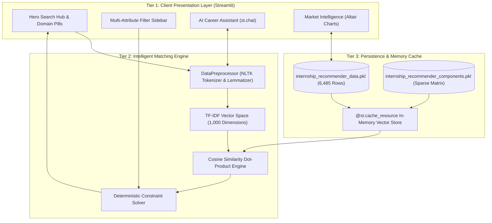

<div align="center">

# 🎓 InternMatch: AI-Powered Internship Recommendation System

**Intelligent Student-Opportunity Matching Platform for Computer Science & Engineering**

[](https://www.python.org/)
[](https://streamlit.io/)
[](https://scikit-learn.org/)
[](https://www.nltk.org/)
[](https://opensource.org/licenses/MIT)

<p align="center">
  A high-throughput, explainable recommendation platform leveraging <b>1,000-dimensional TF-IDF vector spaces</b> and <b>cosine similarity dot-products</b> to match student skill profiles with verified internship postings in under <b>15 milliseconds</b>.
</p>

</div>

---

## 📌 Table of Contents
- [Executive Overview](#-executive-overview)
- [Key Features](#-key-features)
- [Mathematical Formulation](#-mathematical-formulation)
- [Information Retrieval & System Formulation](#-information-retrieval--system-formulation)
- [System Architecture](#-system-architecture)
- [Dataset Characteristics](#-dataset-characteristics)
- [Project Structure](#-project-structure)
- [Installation & Quickstart](#-installation--quickstart)
- [AI / LLM Context Guide](#-ai--llm-context-guide)
- [Academic Metadata](#-academic-metadata)

---

## 🚀 Executive Overview

The **InternMatch Recommendation System** bridges the gap between university students and digital internship opportunities. Traditional keyword search suffers from vocabulary mismatch and cold-start failures. This system implements an optimized, **content-based information retrieval engine** paired with deterministic multi-attribute constraint pruning:

1. **Information Encoding:** Cleans, tokenizes, and lemmatizes student preferences and role postings via NLTK.
2. **High-Dimensional Vector Space:** Encodes features into a precomputed $6485 \times 1000$ sparse TF-IDF term matrix.
3. **Real-Time Inference:** Calculates normalized vector dot-products in `<15ms` latency on CPU hardware.
4. **Explainable AI (XAI):** Highlights overlapping semantic tokens and explains the algorithmic rationale behind each match.

---

## ✨ Key Features

### 1. 🔍 Intelligent Semantic Matching
* **Cosine Similarity Engine:** Calculates mathematical relevance between student technical profiles and 6,485 verified opportunities.
* **Cold-Start Resilience:** Works instantly on day one for new students without requiring historical ratings or collaborative feedback.

### 2. ⚡ 1-Click Career Domain Presets
* Quick-selection pills for major fields:
  * 🤖 **AI & Machine Learning** (Python, PyTorch, Deep Learning, Data Science)
  * 🌐 **Full-Stack Web Dev** (React, Node.js, JavaScript, Python, CSS)
  * 📊 **Data Science & Analytics** (Python, SQL, Pandas, Statistics)
  * ☁️ **Cloud & DevOps** (Docker, Kubernetes, AWS, Linux, CI/CD)
  * 📱 **Mobile App Development** (Flutter, React Native, Android, Kotlin)
  * 📡 **IoT & Embedded Systems** (Embedded C, Arduino, Raspberry Pi, Sensors)
  * 🎨 **UI/UX & Product Design** (Figma, Adobe XD, User Experience)

### 3. 🎯 Multi-Attribute Constraint Solvers
* **Hard Filters:** Enforces strict boolean compliance on minimum monthly stipend (`stipend_numeric`), maximum duration in months (`duration_numeric`), and preferred work mode (Remote / WFH vs. On-Site).

### 4. 💡 Explainable AI (XAI) Badging
* Displays percentage match score (`🎯 96% Match`) with green progress visualization.
* Dynamic green lightbulb callout: `💡 High match because you have skills in Python, DSA, and ML.`

### 5. 📊 Interactive Market Intelligence (EDA)
* Dedicated analytics dashboard built with **Altair**:
  * Top in-demand internship domains.
  * Geographic distribution (44.3% Remote vs. Tech Hubs).
  * Stipend distribution histograms (unpaid vs. paid vs. high-paying).
  * Internship duration curves (1 to 6 months).

### 6. 🤖 Embedded AI Career Assistant
* Streamlit-native conversational interface (`st.chat_message` & `st.chat_input`) providing contextual answers on algorithm mechanics, stipend insights, and communication theory parallels.

---

## 📐 Mathematical Formulation

### 1. Term Frequency-Inverse Document Frequency (TF-IDF)
For a term $t$ in document $d$ within corpus $D$:

$$\text{TF-IDF}(t, d, D) = \text{TF}(t, d) \times \text{IDF}(t, D)$$

Where:
$$\text{TF}(t, d) = \frac{f_{t,d}}{\sum_{t' \in d} f_{t',d}}, \quad \text{IDF}(t, D) = \log\left(\frac{1 + |D|}{1 + |\{d \in D : t \in d\}|}\right) + 1$$

### 2. Cosine Vector Similarity
Let $\vec{u} \in \mathbb{R}^{1000}$ represent the transformed student profile vector, and $\vec{v}_i \in \mathbb{R}^{1000}$ denote the $i$-th internship feature vector:

$$\text{Similarity}(\vec{u}, \vec{v}_i) = \frac{\vec{u} \cdot \vec{v}_i}{\|\vec{u}\|_2 \|\vec{v}_i\|_2} = \frac{\sum_{j=1}^{1000} u_j v_{i,j}}{\sqrt{\sum_{j=1}^{1000} u_j^2} \sqrt{\sum_{j=1}^{1000} v_{i,j}^2}}$$

### 3. Constraint Satisfaction Pruning
Given minimum stipend floor $S_{\min}$, maximum duration bound $D_{\max}$, and location predicate $L$:

$$\mathcal{R}^* = \operatorname{arg\,top}_K \left\{ \text{Similarity}(\vec{u}, \vec{v}_i) \;\Big|\; \text{Stipend}_i \ge S_{\min} \;\wedge\; \text{Duration}_i \le D_{\max} \;\wedge\; \text{LocationMatch}(L, L_i) \right\}$$

---

## 📡 Information Retrieval & System Formulation

This platform formally models recommendation as an **Information Transmission Channel**:

```
[ Student Profile ] ---> [ NLP & TF-IDF Encoder ] ---> [ Digital Recruitment Channel ] ---> [ Cosine Decoder ] ---> [ Matched Opportunity ]
   (Transmitter)            (Channel Coding)               (Noise: Typos & Synonyms)            (Receiver)               (Information Sink)
```

| Information Theory Concept | Recommender System Equivalent |
|:---|:---|
| **Transmitter** | Student Profile / Query Input |
| **Channel Encoder** | NLP Preprocessor & TF-IDF Vectorizer |
| **Channel Noise & Distortion** | Unstructured text, vocabulary mismatches, and ambiguous listings |
| **Mutual Information Maximization** | TF-IDF Cosine dot-product maximizing information transfer |
| **Low-Latency Transmission** | Sub-15ms inference latency across web endpoints |
| **Bandwidth Efficiency** | Precomputed sparse matrix serialization (<280MB RAM footprint) |

---

## 🏛️ System Architecture



---

## 📊 Dataset Characteristics

The underlying corpus consists of **6,485 verified opportunities**:

* **Total Records:** 6,485
* **Unique Hiring Companies:** 4,656
* **Remote / Work From Home Postings:** 2,870 (44.3%)
* **Paid Opportunities:** 6,134 (94.6%)
* **Average Monthly Stipend:** ₹8,500 / month
* **Maximum Monthly Stipend:** ₹80,000 / month
* **Duration Range:** 1 to 6 months (Median: 3 months)

---

## 📁 Project Structure

```
Internship_Recomendation_System/
├── app.py                                                # Production Streamlit Web Application
├── requirements.txt                                      # Pinned Python Dependencies
├── .gitignore                                            # Git Ignore Rules
├── README.md                                             # Comprehensive Project Documentation
│
├── internship.csv                                        # Raw Dataset (6,485 rows)
├── internship_recommender_data_20251025_072624.pkl       # Cleaned Pandas DataFrame
└── internship_recommender_components_20251025_072624.pkl # Serialized TF-IDF Model & Feature Matrix
```

---

## ⚡ Installation & Quickstart

### Prerequisites
* Python 3.10, 3.11, or 3.12
* Git

### Step-by-Step Setup

```bash
# 1. Clone the repository
git clone https://github.com/rupeshsah86/Internship_Recomendation_System.git
cd Internship_Recomendation_System

# 2. Create and activate a virtual environment
python3 -m venv venv
source venv/bin/activate       # On Windows: venv\Scripts\activate

# 3. Install dependencies
pip install -r requirements.txt

# 4. Launch the Streamlit application
streamlit run app.py
```

Open your browser at **`http://localhost:8501`** to interact with the platform.

---

## 🤖 AI / LLM Context Guide

> **Note for AI Coding Assistants (ChatGPT, Claude, Gemini, Copilot):**
> When ingesting this repository:
> - **Primary Entrypoint:** `app.py` contains the Streamlit application and uses `@st.cache_resource` for low-latency inference.
> - **Model Artifacts:** Models are serialized with `joblib`. `internship_recommender_components_...pkl` contains `'tfidf_vectorizer'` and `'feature_matrix'`. `internship_recommender_data_...pkl` contains the preprocessed pandas DataFrame.
> - **Search State Management:** By design, recommendations run **only after the user initiates a search** or selects a preset domain (`st.session_state.has_searched = True`). Before searching, an empty-state welcome card is displayed.
> - **Constraint Logic:** Hard filtering (`min_stipend`, `max_duration`, `location`, `work_mode`) is executed **before slicing `head(top_n)`**, ensuring that exactly Top-N valid results are returned.

---

## 👨‍💻 Academic Metadata

* **Project Title:** AI-Powered Internship Recommendation System
* **Author / Developer:** Rupesh Kumar Sah
* **Department:** Computer Science and Engineering (CSE)
* **Institution:** Sri Eshwar College of Engineering
* **Email:** rupeshkumarsah.2024cse@sece.ac.in
* **Repository:** [github.com/rupeshsah86/Internship_Recomendation_System](https://github.com/rupeshsah86/Internship_Recomendation_System)

---

<div align="center">
  <sub>Built with ❤️ by Rupesh Kumar Sah for modern student career mobility.</sub>
</div>
